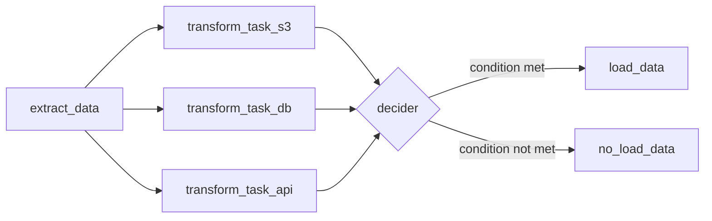

How to work with Apache Aiurflow

The pipeline builts, parallel processing , xcom processes, syncing of dag files 
Performing the execution in airflow locally in locahost:8080
setting the postgreport manually to 3456
The container is airflow created in docker

Work with branch (task.branch) decorator to create a  decider in 7_branch.py
## Branching Pipeline (Airflow)

An Airflow DAG that extracts data, runs three transformations in parallel, and uses a branch task to decide whether the load step should run.


### Flow



### Tasks

| Task | Type | Purpose |
|------|------|---------|
| `extract_data` | `@task` | Pulls the source data [describe source] |
| `transform_task_s3` | `@task` | Transforms the S3-sourced data |
| `transform_task_db` | `@task` | Transforms the database-sourced data |
| `transform_task_api` | `@task` | Transforms the API-sourced data |
| `decider` | `@task.branch` | Checks [your condition] and returns the task_id of the next step |
| `load_data` | `@task.bash` | Runs when the branch condition passes |
| `no_load_data` | `@task.bash` | Runs when the condition fails (skipped in the run shown above) |

### How the branching works

- The three transforms run in parallel after `extract_data`.
- `decider` runs only after all three succeed. It returns either `"load_data"` or `"no_load_data"`.
- Airflow marks the branch that wasn't chosen as **skipped**. In the run above, `load_data` succeeded and `no_load_data` was skipped.

### Run it

```bash
airflow dags trigger <your_dag_id>
```
